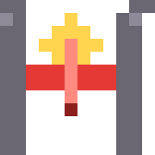
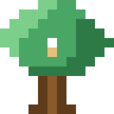
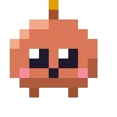

This banner was made with <a href="https://github.com/flaviorg/motion-studio">motion-studio</a>, my Claude Code skill — every frame written in code.

**Senior Full-Stack & AI Engineer** &nbsp;·&nbsp; TED.com and the TED app &nbsp;·&nbsp; Braga, Portugal

  

## About

- **TED** — I work on the front end of [TED.com](https://www.ted.com) (20M+ monthly visitors) and on the TED app in React Native (30M+ downloads on Android alone).
- **9+ years** building web and mobile products for companies in the US and Brazil.
- **AI engineering** — agents, MCP servers, RAG with eval gates in CI, and tooling for Claude Code.
- Remote from **Portugal** and **open to freelance projects** → [oflavio.dev](https://oflavio.dev)

## Open source

### Claude Code mods

Mods for Claude Code, written from scratch against the official mods API.

<table>
  <tr>
    <td width="64" align="center"></td>
    <td><a href="https://github.com/flaviorg/tripwire"><b>tripwire</b></a> Holds a destructive command and shows what it would destroy before it runs. Cancel is the default.</td>
  </tr>
  <tr>
    <td width="64" align="center"></td>
    <td><a href="https://github.com/flaviorg/canopy"><b>canopy</b></a> The project's file tree beside the chat. Every file Claude touches keeps its state in its own color.</td>
  </tr>
  <tr>
    <td width="64" align="center"></td>
    <td><a href="https://github.com/flaviorg/crew"><b>crew</b></a> A live panel of the subagents Claude delegates to, each with its own animated pixel mascot.</td>
  </tr>
</table>

crew in a live session: three subagents, each with its own mascot, tokens, cost and time.

### Video with Claude Code

<table>
  <tr>
    <td width="50%" valign="top"></td>
    <td width="50%" valign="top">
      <a href="https://github.com/flaviorg/motion-studio"><b>motion-studio</b></a> 
      A Claude Code plugin that turns a one-line brief into a finished motion-graphics MP4: real brand capture, a beat-grid plan, a soundtrack synthesized in code and a scored critique loop.
        
      <a href="https://github.com/flaviorg/reelforge"><b>reelforge</b></a> 
      Claude Code skills that turn a raw talking-head take into a tight, branded short-form video: dead air and retakes cut, word-synced cards and captions.
    </td>
  </tr>
</table>

## AI engineering

<table>
  <tr>
    <th width="25%" align="left">Project</th>
    <th align="left">What it does</th>
  </tr>
  <tr>
    <td valign="top"><a href="https://github.com/flaviorg/incident-copilot"><b>incident-copilot</b></a> <a href="https://flaviorg.github.io/incident-copilot/">Live demo</a></td>
    <td valign="top">Multi-agent incident copilot in LangGraph and TypeScript. The model proposes; code and humans decide. Approval gate, MCP and a War Room UI.</td>
  </tr>
  <tr>
    <td valign="top"><a href="https://github.com/flaviorg/agent-flight-recorder"><b>agent-flight-recorder</b></a></td>
    <td valign="top">A black box for AI agents: records every LLM, tool, clock and random step, replays a run offline, diffs two runs, forks at step N and turns a failed run into a regression test.</td>
  </tr>
  <tr>
    <td valign="top"><a href="https://github.com/flaviorg/legacy-archaeologist"><b>legacy-archaeologist</b></a></td>
    <td valign="top">Characterization tests and a living spec for legacy JavaScript. The real code, not the LLM, writes every expected value, and a mutation score shows whether the tests catch changes.</td>
  </tr>
  <tr>
    <td valign="top"><a href="https://github.com/flaviorg/secure-legacy-mcp"><b>secure-legacy-mcp</b></a></td>
    <td valign="top">Turns a legacy API into a secure MCP server: hashed service tokens, RBAC, rate limits, a clean stdout and an npx package.</td>
  </tr>
  <tr>
    <td valign="top"><a href="https://github.com/flaviorg/docs-data-assistant"><b>docs-data-assistant</b></a></td>
    <td valign="top">RAG that cites its sources and refuses when evidence is weak, or validated Text-to-SQL, with injection guardrails and an eval gate in CI.</td>
  </tr>
  <tr>
    <td valign="top"><a href="https://github.com/flaviorg/maestri-squad"><b>maestri-squad</b></a></td>
    <td valign="top">One Markdown file that turns your Maestri Maestro into the lead of a multi-agent software squad.</td>
  </tr>
</table>

## Stack

<table>
  <tr>
    <td width="50%" valign="top"><b>Frontend</b>  </td>
    <td width="50%" valign="top"><b>Mobile</b> </td>
  </tr>
  <tr>
    <td valign="top"><b>Backend, APIs &amp; CMS</b>  </td>
    <td valign="top"><b>Databases &amp; ORMs</b>   </td>
  </tr>
  <tr>
    <td valign="top"><b>Quality &amp; Observability</b>  </td>
    <td valign="top"><b>Cloud &amp; DevOps</b> </td>
  </tr>
  <tr>
    <td valign="top"><b>AI Engineering</b> </td>
    <td valign="top"><b>AI Coding</b> </td>
  </tr>
</table>

Icons: <a href="https://github.com/syvixor/skills-icons">Syvixor Skills Icons</a> (MIT); Embrace tile drawn in the same style from Embrace's logo.

---

Open to freelance projects → <a href="https://oflavio.dev">oflavio.dev</a> &nbsp;·&nbsp; <a href="mailto:flaviorgouveia@gmail.com">flaviorgouveia@gmail.com</a>

