

<a href="#">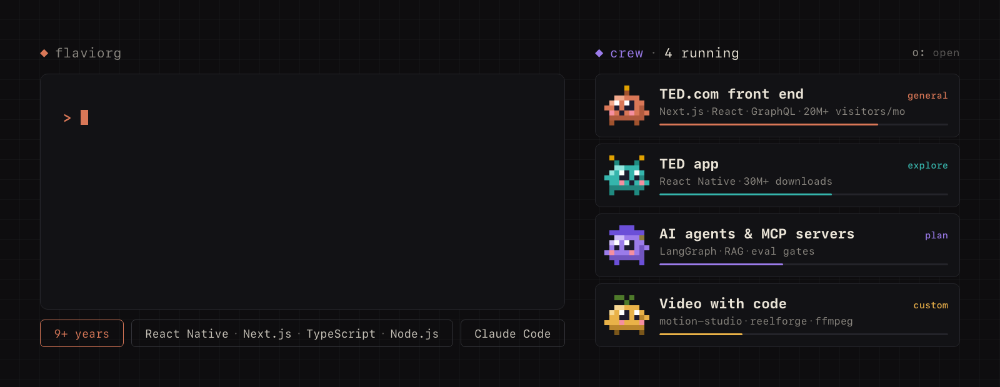</a>

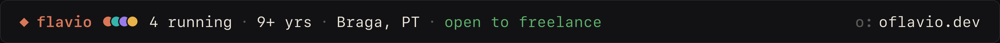

<a href="https://oflavio.dev">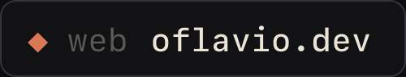</a>&nbsp;<a href="https://www.linkedin.com/in/flaviorgdev">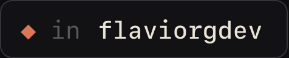</a>&nbsp;<a href="mailto:flaviorgouveia@gmail.com">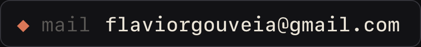</a>&nbsp;

 

 

<a href="https://github.com/flaviorg/claude-mods">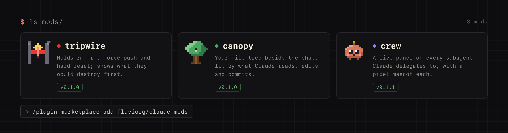</a>

<a href="https://github.com/flaviorg/tripwire">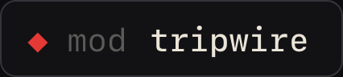</a>&nbsp;<a href="https://github.com/flaviorg/canopy">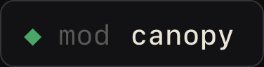</a>&nbsp;<a href="https://github.com/flaviorg/crew">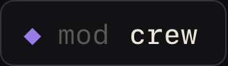</a>&nbsp;<a href="https://github.com/flaviorg/claude-mods">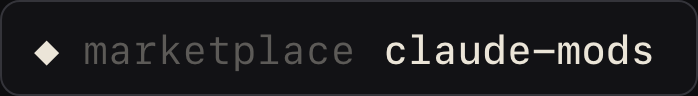</a>

crew in a real session. Recorded, not drawn.

 

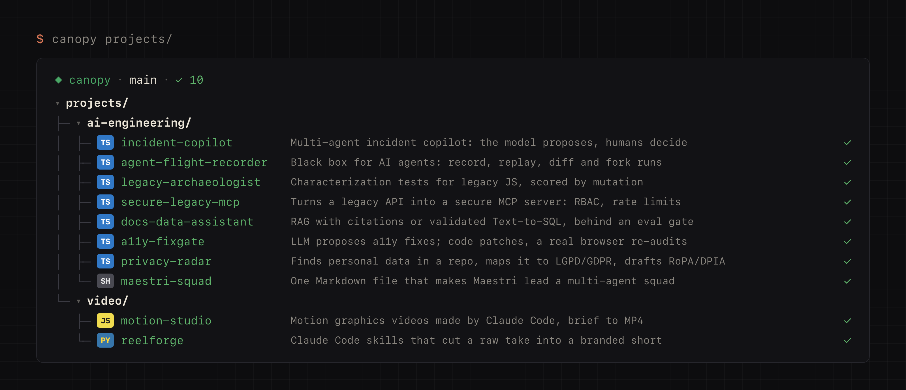

<a href="https://github.com/flaviorg/incident-copilot">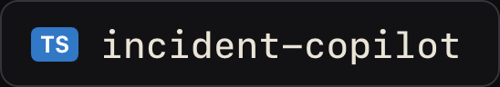</a>&nbsp;<a href="https://github.com/flaviorg/agent-flight-recorder">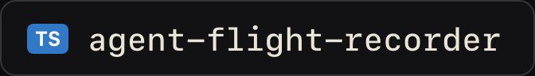</a>&nbsp;<a href="https://github.com/flaviorg/legacy-archaeologist">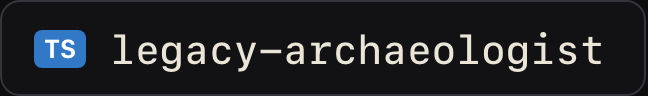</a>&nbsp;<a href="https://github.com/flaviorg/secure-legacy-mcp">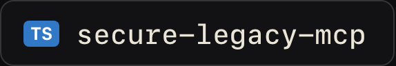</a>&nbsp;<a href="https://github.com/flaviorg/docs-data-assistant">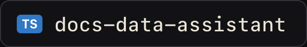</a>&nbsp;<a href="https://github.com/flaviorg/maestri-squad">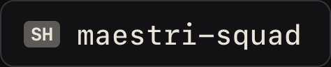</a>&nbsp;<a href="https://github.com/flaviorg/motion-studio">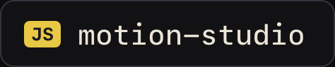</a>&nbsp;<a href="https://github.com/flaviorg/reelforge">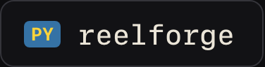</a>

 

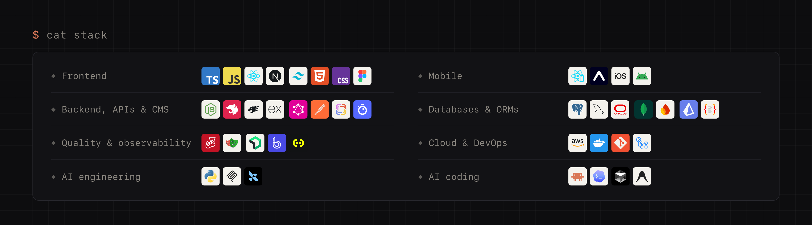

<a href="https://oflavio.dev">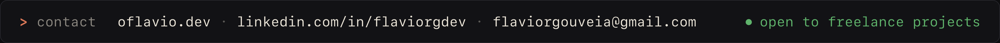</a>

Every image on this page was drawn by code, in the style of my Claude Code mods. The mascots are crew's own.

