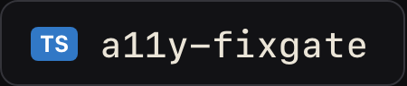
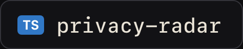

<a href="#"><picture><source media="(prefers-color-scheme: light)" srcset="assets/v2/hero-light.gif"></picture></a>

<picture><source media="(prefers-color-scheme: light)" srcset="assets/v2/band-light.png"></picture>

<a href="https://oflavio.dev"><picture><source media="(prefers-color-scheme: light)" srcset="assets/v2/badge-website-light.png"></picture></a>&nbsp;<a href="https://www.linkedin.com/in/flaviorgdev"><picture><source media="(prefers-color-scheme: light)" srcset="assets/v2/badge-linkedin-light.png"></picture></a>&nbsp;<a href="mailto:flaviorgouveia@gmail.com"><picture><source media="(prefers-color-scheme: light)" srcset="assets/v2/badge-email-light.png"></picture></a>&nbsp;<a href="https://oflavio.dev"><picture><source media="(prefers-color-scheme: light)" srcset="assets/v2/badge-freelance-light.png"></picture></a>

 

<picture><source media="(prefers-color-scheme: light)" srcset="assets/v2/section-about-light.png"></picture>

**Senior Full-Stack & AI Engineer**, 9+ years building web and mobile products for companies in the US and Brazil. At [TED Conferences](https://www.ted.com): the front end of TED.com (20M+ monthly visitors) and the TED app in React Native (30M+ downloads on Android alone). AI engineering: agents that know when not to act, MCP servers you can trust, RAG with eval gates in CI, Claude Code mods and skills. Video with code: Claude Code skills that edit talking-head takes and produce motion graphics. Remote from Portugal, EU/US overlap. Portuguese (native), English (C1). B.Sc. Information Systems (UFSC). Open to freelance projects.

 

<a href="https://github.com/flaviorg/claude-mods"><picture><source media="(prefers-color-scheme: light)" srcset="assets/v2/section-mods-light.png"></picture></a>

<a href="https://github.com/flaviorg/tripwire"><picture><source media="(prefers-color-scheme: light)" srcset="assets/v2/badge-repo-tripwire-light.png"></picture></a>&nbsp;<a href="https://github.com/flaviorg/canopy"><picture><source media="(prefers-color-scheme: light)" srcset="assets/v2/badge-repo-canopy-light.png"></picture></a>&nbsp;<a href="https://github.com/flaviorg/crew"><picture><source media="(prefers-color-scheme: light)" srcset="assets/v2/badge-repo-crew-light.png"></picture></a>&nbsp;<a href="https://github.com/flaviorg/claude-mods"><picture><source media="(prefers-color-scheme: light)" srcset="assets/v2/badge-repo-claude-mods-light.png"></picture></a>

- **[tripwire](https://github.com/flaviorg/tripwire)**: holds `rm -rf`, force push, hard reset and `DROP TABLE` and shows what they would destroy before they run. Cancel is the default.
- **[canopy](https://github.com/flaviorg/canopy)**: your project's file tree beside the chat. Every file Claude reads, edits or commits keeps its state in its own color.
- **[crew](https://github.com/flaviorg/crew)**: a live panel of the subagents Claude delegates to: model, context, tokens, cost and time, each with its own pixel mascot.
- **[claude-mods](https://github.com/flaviorg/claude-mods)**: the family marketplace. `/plugin marketplace add flaviorg/claude-mods`, then install any of them.

crew in a real session. Recorded, not drawn.

 

<picture><source media="(prefers-color-scheme: light)" srcset="assets/v2/section-projects-light.png"></picture>

<a href="https://github.com/flaviorg/incident-copilot"><picture><source media="(prefers-color-scheme: light)" srcset="assets/v2/badge-repo-incident-copilot-light.png"></picture></a>&nbsp;<a href="https://github.com/flaviorg/agent-flight-recorder"><picture><source media="(prefers-color-scheme: light)" srcset="assets/v2/badge-repo-agent-flight-recorder-light.png"></picture></a>&nbsp;<a href="https://github.com/flaviorg/legacy-archaeologist"><picture><source media="(prefers-color-scheme: light)" srcset="assets/v2/badge-repo-legacy-archaeologist-light.png"></picture></a>&nbsp;<a href="https://github.com/flaviorg/secure-legacy-mcp"><picture><source media="(prefers-color-scheme: light)" srcset="assets/v2/badge-repo-secure-legacy-mcp-light.png"></picture></a>&nbsp;<a href="https://github.com/flaviorg/docs-data-assistant"><picture><source media="(prefers-color-scheme: light)" srcset="assets/v2/badge-repo-docs-data-assistant-light.png"></picture></a>&nbsp;<a href="https://github.com/flaviorg/a11y-fixgate"><picture><source media="(prefers-color-scheme: light)" srcset="assets/v2/badge-repo-a11y-fixgate-light.png"></picture></a>&nbsp;<a href="https://github.com/flaviorg/privacy-radar"><picture><source media="(prefers-color-scheme: light)" srcset="assets/v2/badge-repo-privacy-radar-light.png"></picture></a>&nbsp;<a href="https://github.com/flaviorg/maestri-squad"><picture><source media="(prefers-color-scheme: light)" srcset="assets/v2/badge-repo-maestri-squad-light.png"></picture></a>&nbsp;<a href="https://github.com/flaviorg/motion-studio"><picture><source media="(prefers-color-scheme: light)" srcset="assets/v2/badge-repo-motion-studio-light.png"></picture></a>&nbsp;<a href="https://github.com/flaviorg/reelforge"><picture><source media="(prefers-color-scheme: light)" srcset="assets/v2/badge-repo-reelforge-light.png"></picture></a>

**AI engineering.** The pattern in all of them: the model proposes, deterministic code and humans decide.
- **[incident-copilot](https://github.com/flaviorg/incident-copilot)**: multi-agent incident copilot (LangGraph + TypeScript) with an approval gate, MCP and a War Room.
- **[agent-flight-recorder](https://github.com/flaviorg/agent-flight-recorder)**: the black box for AI agents. Record every LLM, tool, clock and random step; replay offline, diff two runs, fork at step N, turn a failed run into a regression test.
- **[legacy-archaeologist](https://github.com/flaviorg/legacy-archaeologist)**: characterization tests and a living spec for legacy JavaScript. The real code writes every expected value; a mutation score says whether the tests catch changes.
- **[secure-legacy-mcp](https://github.com/flaviorg/secure-legacy-mcp)**: turns a legacy API into a secure MCP server. Hashed service tokens, RBAC, rate limits, clean stdout, `npx` package.
- **[docs-data-assistant](https://github.com/flaviorg/docs-data-assistant)**: RAG with refusal and citations, or validated Text-to-SQL, with injection guardrails and an eval gate in CI.
- **[a11y-fixgate](https://github.com/flaviorg/a11y-fixgate)**: LLM-assisted accessibility fixer. The model only proposes values; code builds bounded patches and a real-browser axe re-audit decides.
- **[privacy-radar](https://github.com/flaviorg/privacy-radar)**: scans a Node/TypeScript repo for personal data, maps each finding to LGPD and GDPR articles and drafts RoPA/DPIA documents.
- **[maestri-squad](https://github.com/flaviorg/maestri-squad)**: one Markdown file that turns a Maestri Maestro into the lead of a multi-agent software squad.

**Video with code.**
- **[motion-studio](https://github.com/flaviorg/motion-studio)**: motion graphics videos made by Claude Code. Brief, real brand capture, beat grid, sound in code, scored critique loop, MP4.
- **[reelforge](https://github.com/flaviorg/reelforge)**: Claude Code skills that turn a raw talking-head take into a tight, branded short-form video.

 

<picture><source media="(prefers-color-scheme: light)" srcset="assets/v2/section-stack-light.png"></picture>

**Stack.** TypeScript, JavaScript, React, Next.js, Tailwind CSS, Figma · React Native, Expo, iOS, Android · Node.js, NestJS, Fastify, Express, GraphQL, REST, Prismic, Algolia · PostgreSQL, MySQL, Oracle, MongoDB, Firebase, Prisma, TypeORM · Jest, Playwright, New Relic, Bugsnag, Embrace · AWS, Docker, GitHub Actions · Python, MCP, LangChain, LangGraph · Claude Code, Codex, Cursor, Antigravity.

<a href="https://oflavio.dev"><picture><source media="(prefers-color-scheme: light)" srcset="assets/v2/section-contact-light.png"></picture></a>

**Contact.** [oflavio.dev](https://oflavio.dev) · [LinkedIn](https://www.linkedin.com/in/flaviorgdev) · [Instagram](https://www.instagram.com/oflavio.dev) · [flaviorgouveia@gmail.com](mailto:flaviorgouveia@gmail.com) · open to freelance projects.

Every image on this page was drawn by code, in the style of my Claude Code mods. The mascots are crew's own.

