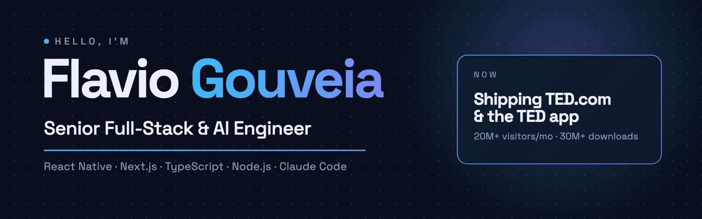

This banner was made with <a href="https://github.com/flaviorg/motion-studio">motion-studio</a>, my Claude Code skill — every frame written in code.

  

 

---

## 👋 About me

I'm a **Senior Full-Stack Engineer** with **8+ years** building web and mobile products for
companies in the US and Brazil — today at **[TED](https://www.ted.com)**, working on TED.com and
the TED app. I also build **AI engineering** projects: agents that know when *not* to act,
MCP servers you can actually trust, and Claude Code workflows that ship real artifacts.

- 🎤 **TED** — TED.com and the TED mobile app (React Native)
- 🧠 **AI engineering** — multi-agent systems, MCP servers, RAG with refusals, guardrails and eval gates in CI
- 🎬 **Video with code** — Claude Code skills that edit talking-head takes and produce motion graphics
- 🌍 Remote from **Braga, Portugal** · 🎓 B.Sc. in Information Systems
- 💼 **Open to freelance projects** → [oflavio.dev](https://oflavio.dev)

## 🚀 Featured projects

<table>
  <tr>
    <td width="50%" valign="top">
      
      <h3><a href="https://github.com/flaviorg/motion-studio">🎬 motion-studio</a></h3>
      A Claude Code plugin that turns a one-line brief into a finished motion-graphics MP4 —
      real brand capture, a beat-grid plan, a soundtrack synthesized in code and a scored critique loop.
        
      
      
      
      
    </td>
    <td width="50%" valign="top">
      
      <h3><a href="https://github.com/flaviorg/incident-copilot">🚨 incident-copilot</a></h3>
      A multi-agent incident copilot: a LangGraph supervisor coordinates telemetry, runbook,
      planning and audit agents. The model proposes; code and humans decide.
      <a href="https://flaviorg.github.io/incident-copilot/"><b>Live War Room demo →</b></a>
        
      
      
      
    </td>
  </tr>
</table>

<table>
  <tr>
    <td width="33%" valign="top">
      <h3><a href="https://github.com/flaviorg/reelforge">🎞️ reelforge</a></h3>
      Claude Code skills that turn a raw talking-head take into a tight, branded short-form
      video — dead air and retakes cut, word-synced cards and captions.
        
      
      
    </td>
    <td width="33%" valign="top">
      <h3><a href="https://github.com/flaviorg/secure-legacy-mcp">🔐 secure-legacy-mcp</a></h3>
      Turns a hostile legacy REST API into five safe MCP actions for AI agents — hashed
      service tokens, server-side RBAC, rate limits and a clean stdout.
        
      
      
      
    </td>
    <td width="33%" valign="top">
      <h3><a href="https://github.com/flaviorg/docs-data-assistant">📚 docs-data-assistant</a></h3>
      RAG that cites its sources and refuses when evidence is weak, plus read-only
      Text-to-SQL with five layers of defense and an eval gate in CI.
        
      
      
      
    </td>
  </tr>
</table>

## 🛠️ Tech stack

<table>
  <tr>
    <td><b>Web &amp; Mobile</b></td>
    <td>&nbsp; </td>
  </tr>
  <tr>
    <td><b>Backend</b></td>
    <td>&nbsp;</td>
  </tr>
  <tr>
    <td><b>ORMs</b></td>
    <td>&nbsp;</td>
  </tr>
  <tr>
    <td><b>APIs &amp; Data</b></td>
    <td>&nbsp;</td>
  </tr>
  <tr>
    <td><b>Cloud &amp; DevOps</b></td>
    <td></td>
  </tr>
  <tr>
    <td><b>AI Engineering</b></td>
    <td>&nbsp;  </td>
  </tr>
  <tr>
    <td><b>AI Coding</b></td>
    <td>   </td>
  </tr>
  <tr>
    <td><b>Tools</b></td>
    <td>&nbsp;</td>
  </tr>
</table>

## 🤝 Let's connect

Building something with React Native, Next.js or AI agents? I'm open to freelance work and
interesting collaborations.

